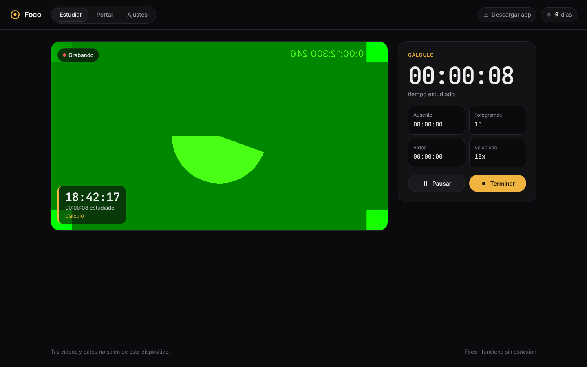
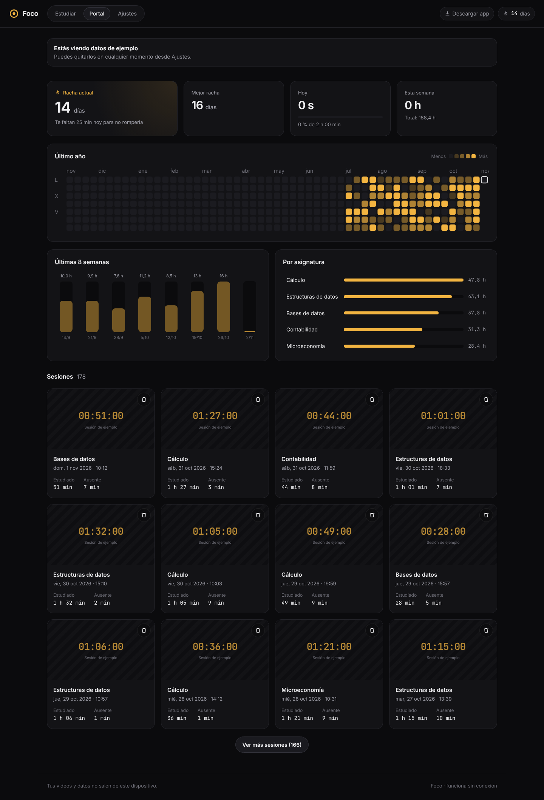
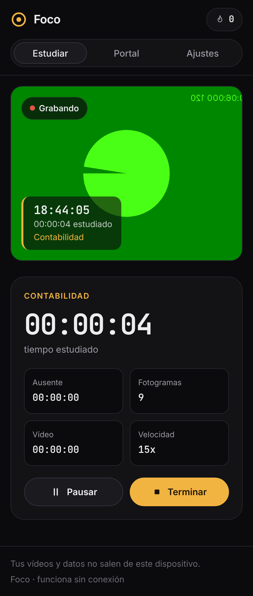

# Foco · Estudia en cámara rápida

> Graba tus sesiones de estudio con la webcam, llévate un vídeo acelerado con la hora sobreimpresa y no rompas la racha. Todo en tu dispositivo, sin conexión.

**Demo:** https://davidsmarandescu.github.io/Foco/ · **App de escritorio** (macOS, Windows, Linux): [descargar](https://github.com/DavidSmarandescu/Foco/releases/latest)



## El problema

Los vídeos de estudio en cámara rápida (*study with me*, *timelapse*) son una forma muy popular de mantener la constancia y compartir el esfuerzo. Hacerlos hoy es incómodo:

- Grabar dos horas de vídeo y acelerarlo después con un editor ocupa gigas y lleva tiempo.
- Los cronómetros de estudio cuentan el tiempo con la app abierta, no el tiempo que de verdad estás delante.
- Las apps de productividad piden cuenta y suben datos a un servidor. Una cámara apuntando a tu cuarto es de lo más sensible que hay.

## La solución

**Foco** es una web instalable (PWA) que:

1. **Graba en cámara rápida en directo.** Guarda un fotograma cada 2 s (configurable) en lugar de vídeo continuo: una hora de estudio ocupa unos 30 MB de fotos en vez de varios gigas.
2. **Sobreimprime la hora** real de cada fotograma, la fecha, el tiempo estudiado y la asignatura en una esquina del vídeo.
3. **Pausa sola si te vas.** Un detector de caras que corre en el propio navegador, más una señal de movimiento, detecta si estás. Si no te ve durante 20 s, el cronómetro se para, deja de grabar y ese tramo se cuenta como ausencia.
4. **Monta el vídeo al terminar**, más rápido que en tiempo real: una sesión de 1 h a 60x da 1 minuto de MP4 en pocos segundos.
5. **Portal de progreso:** racha actual y mejor racha, calendario del último año, totales semanales, tiempo por asignatura, objetivo diario y todas las sesiones con su vídeo para ver o descargar.

| Portal | Móvil |
| --- | --- |
|  |  |

## Privacidad y modo sin conexión

- **Nada sale del dispositivo.** No hay backend, cuentas ni analítica. Fotogramas, vídeos y estadísticas viven en IndexedDB del navegador.
- **El modelo de visión va dentro de la app.** El runtime WASM de MediaPipe y el modelo BlazeFace (230 KB) se sirven desde la propia web, no desde un CDN.
- **Funciona sin red.** Un service worker precachea toda la app, incluido el runtime de visión y las fuentes, en la primera visita. Después funciona en modo avión.
- **Copias de seguridad en JSON** (sesiones, rachas y ajustes) y botón para pedir almacenamiento persistente (`navigator.storage.persist()`) y que el navegador no borre los datos.

## App de escritorio

En la web, los datos viven en el navegador: si borras los datos del sitio (por ejemplo, al borrar las cookies), se pierden. La app de escritorio es la misma Foco, pero **guarda todo en tu ordenador**.

**Descarga** la última versión en [Releases](https://github.com/DavidSmarandescu/Foco/releases/latest):

| Sistema | Archivo |
| --- | --- |
| macOS con Apple Silicon (M1, M2, M3…) | `Foco-x.y.z-mac-arm64.dmg` |
| macOS con Intel | `Foco-x.y.z-mac-x64.dmg` |
| Windows 10/11 | `Foco-x.y.z-windows-setup.exe` |
| Linux | `Foco-x.y.z-linux-x86_64.AppImage` |

### Primera apertura

La app no está firmada con un certificado de pago, así que el sistema avisa la primera vez. Solo hay que hacerlo una vez:

- **macOS:** abre el `.dmg` y arrastra Foco a Aplicaciones. Al abrirla, macOS dirá que no puede verificar al desarrollador: pulsa **Hecho**, ve a **Ajustes del Sistema → Privacidad y seguridad**, baja hasta el aviso de Foco y pulsa **Abrir igualmente**. Si dice que la app «está dañada», ejecuta en Terminal `xattr -cr /Applications/Foco.app` y vuelve a abrirla. Después, acepta el permiso de cámara.
- **Windows:** si aparece «Windows protegió su PC» (SmartScreen), pulsa **Más información → Ejecutar de todas formas** y sigue el instalador.
- **Linux:** da permiso de ejecución y ábrela: `chmod +x Foco-*.AppImage && ./Foco-*.AppImage`.

### Dónde se guardan tus datos

- **Carpeta de Foco:** `Documentos/Foco` (se puede cambiar en Ajustes). Ahí se guarda cada vídeo como MP4 en `videos/` y tus sesiones, rachas y ajustes en `foco-datos.json`, que se actualiza tras cada cambio.
- **Si reinstalas Foco** o cambias de usuario, la app detecta esa carpeta y ofrece **restaurar** sesiones y vídeos. Si eliges «Empezar de cero», la copia anterior se conserva como `foco-datos-anterior-<fecha>.json`.
- **Borrar una sesión en Foco no borra su MP4** de la carpeta: los vídeos son tuyos.
- Además, la app mantiene la cámara rápida aunque la ventana quede detrás de otra y la pantalla encendida mientras estudias.

## Decisiones técnicas

| Decisión | Por qué |
| --- | --- |
| **Fotogramas JPEG en IndexedDB** en vez de grabar vídeo continuo | Ocupa ~100 veces menos, y si se cierra la pestaña no se pierde nada: al volver, Foco ofrece *Generar vídeo* con lo guardado. |
| **Hora «quemada» en cada fotograma** al capturarlo | La hora es la del momento real, no la del montaje, y el vídeo final no necesita postproceso. |
| **WebCodecs + [Mediabunny](https://mediabunny.dev)** para el vídeo | Codifica H.264/MP4 más rápido que en tiempo real. Si no hay H.264, usa VP9/VP8 en WebM; sin WebCodecs, recurre a `MediaRecorder`. Se carga bajo demanda al terminar la primera sesión. |
| **MediaPipe BlazeFace + movimiento** | Mirar hacia abajo para escribir puede despistar al detector de caras. Sumar el movimiento evita pausas falsas. El modo «Solo cara» es más estricto. |
| **Tolerancia y reclasificación** de la ausencia | Un fallo puntual del detector no pausa nada. Cuando sí pausa, el tramo desde la última vez que se te vio pasa de «estudiado» a «ausente», así el tiempo es honesto. |
| **Días locales** en rachas y calendario | Una sesión a las 00:30 cuenta para el día del calendario del usuario, y las rachas no se rompen con el cambio de hora (hay tests de ambos). |
| **Lógica pura con tests** (`src/lib`) | Rachas, agregados, reloj de estudio, presencia, formatos, validación de ajustes y copias, y las escrituras en disco de la app de escritorio tienen tests en Vitest (39). |
| **Vite + React + TypeScript**, sin backend | Se despliega como web estática en GitHub Pages con un workflow que pasa los tests antes de publicar. |
| **Electron para escritorio**, con la misma web | Lleva el mismo Chromium con el que está probada la web (cámara, WebCodecs, MediaPipe), así que no hay sorpresas por motor. La web se sirve desde un protocolo propio (`app://foco`) con CSP estricta. La página no tiene acceso a Node (`contextIsolation`, `sandbox`): solo a un puente mínimo cuyas escrituras se validan y se limitan a la carpeta de Foco. |
| **IndexedDB sigue siendo el almacén principal** en escritorio | Es el código ya probado. El disco es un espejo (MP4 + JSON) que sobrevive a reinstalar y que el usuario puede abrir y copiar. |
| **Instaladores en GitHub Actions** | Al subir una etiqueta `vX.Y.Z`, se compilan el `.dmg`, el `.exe` y el `.AppImage` en macOS, Windows y Linux y se publican en la release. |

### Estructura

```
src/
  lib/          lógica pura y testeada (rachas, reloj, presencia, timelapse, ajustes)
  media/        cámara, superposición, detector de presencia, codificador, cierre de sesión
  storage/      IndexedDB y copias de seguridad
  components/   vistas: Estudiar, Portal, Ajustes, calendario
  desktop/      puente con la app de escritorio y espejo en disco
electron/       proceso principal, preload y utilidades de disco (app de escritorio)
scripts/        copia del runtime de MediaPipe, iconos y pruebas de extremo a extremo
```

## Modelo de negocio

- **Gratis y sin conexión** para siempre: grabar, cámara rápida, racha y portal. Es el gancho y lo que se comparte, porque cada vídeo publicado en redes lleva la marca de agua discreta «Foco».
- **Foco Pro, pago único (≈ 9,99 €):** sin marca de agua, exportación a 4K y a formato vertical para redes, plantillas de superposición (pomodoro, objetivo, música), estadísticas avanzadas (horas productivas, constancia por asignatura) y temas. Un pago único encaja con una app sin servidores: no hay costes recurrentes que justifiquen una suscripción.
- **Licencias para academias y residencias de estudiantes:** salas de estudio con objetivos de grupo y rankings opcionales. Seguiría funcionando en local y solo se compartirían los totales que el alumno decida.

Coste marginal por usuario: prácticamente cero (web estática, sin servidores ni almacenamiento propio).

## Ejecutar en local

```bash
npm install
```
```bash
npm run dev
```
```bash
npm test
```
```bash
npm run build
```

App de escritorio en desarrollo (Vite + Electron con recarga):

```bash
npm run desktop:dev
```

Instalador para tu sistema, en `release/`:

```bash
npm run desktop:build
```

Para publicar una versión con instaladores para los tres sistemas, sube una etiqueta (actualiza antes `version` en `package.json`):

```bash
git tag v0.1.0 && git push origin v0.1.0
```

La cámara solo funciona en `localhost` o HTTPS. En el portal, **«Ver con datos de ejemplo»** carga 4 meses de sesiones ficticias para enseñar las rachas y el calendario sin esperar.

## Limitaciones conocidas

- **App de escritorio sin firmar.** macOS y Windows avisan en la primera apertura (ver arriba). Firmar y notarizar requiere cuentas de pago de Apple (99 $/año) y un certificado de Windows. Tampoco hay actualizaciones automáticas: las versiones nuevas se descargan desde Releases.
- **Pestaña en segundo plano (web).** Los navegadores ralentizan los temporizadores de las pestañas ocultas, así que se pueden perder fotogramas si cambias de pestaña durante mucho tiempo. El tiempo estudiado se calcula con marcas de tiempo y sigue siendo correcto. Foco mantiene la pantalla encendida con la Wake Lock API.
- **Detección de presencia.** Es heurística: con «Cara + movimiento», una mascota o una cortina moviéndose pueden contar como presencia. Con «Solo cara», mirar muy abajo puede pausar. La pausa tolerante (20 s, configurable) suaviza ambos casos.
- **Margen antes de pausar.** Los fotogramas capturados durante el margen de tolerancia (antes de dar a alguien por ausente) se quedan en el vídeo, aunque ese tiempo se reclasifique como ausencia.
- **Recuperación tras un cierre.** El progreso se guarda cada 5 s y en cada fotograma, así que un cierre inesperado puede perder los últimos segundos de cronómetro, nunca los fotogramas ya guardados.
- **Sesiones que cruzan la medianoche.** Cuentan para el día en que empezaron.
- **Primera visita.** Descarga unos 15 MB, sobre todo el runtime de visión, para poder funcionar sin red después. En navegadores sin SIMD en WASM, el detector se descarga la primera vez que se usa.
- **Copias de seguridad (web).** No incluyen los vídeos (pesan demasiado). Se descargan uno a uno desde el portal. En la app de escritorio los vídeos ya están en la carpeta de Foco.

## Roadmap

- Exportación vertical 9:16 y plantillas de superposición (Pro).
- Modo pomodoro con descansos que no rompen la cámara rápida.
- Música o sonido ambiente en el vídeo final.
- Sincronización opcional y cifrada de extremo a extremo entre dispositivos.
- Salas de estudio para academias.
